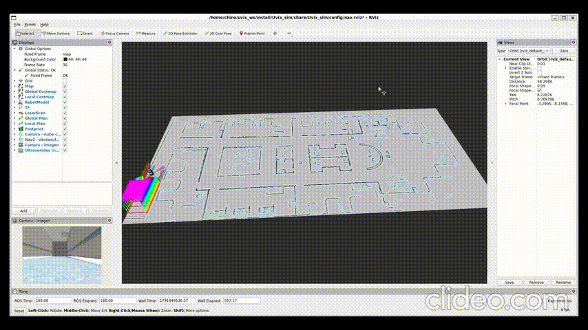
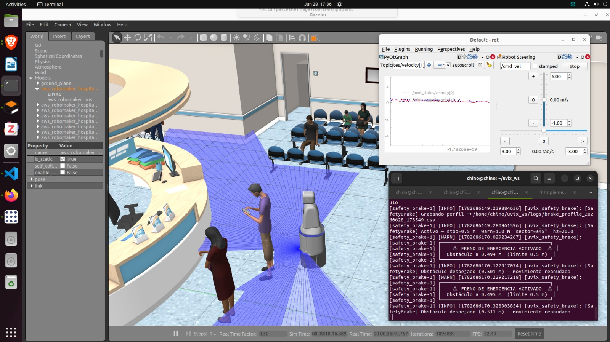
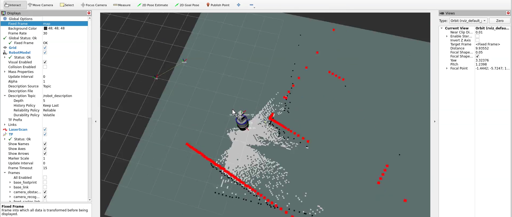

# UVIX Robot asistencial para adultos mayores (ROS 2 Humble)

UVIX es un robot móvil diferencial pensado para acompañar a adultos mayores en hospitales y
residencias. Este workspace contiene la simulación en Gazebo, el SLAM, la navegación autónoma con
Nav2 y la interfaz `ros2_control` para el robot real.

<p align="center">
  
</p>

<p align="center">
  
  
</p>

---

## Paquetes

Cada paquete tiene su propio README con el detalle de sus nodos, topics y parámetros.

| Paquete | Tipo | Qué hace |
|---|---|---|
| [`uvix_sim`](src/uvix_sim/README.md) | ament_python | Simulación en Gazebo: modelo del robot, mundos de hospital, controladores, EKF, `twist_mux` y nodos auxiliares (patrulla, watchers). |
| [`uvix_slam`](src/uvix_slam/README.md) | ament_python | Mapeo y localización con `slam_toolbox`. |
| [`uvix_nav`](src/uvix_nav/README.md) | ament_python | Navegación autónoma con Nav2 (planner, controlador DWB, costmaps). |
| [`uvix_description`](src/uvix_description/README.md) | ament_cmake | Descripción del robot real con `ros2_control`. |
| [`uvix_hadware`](src/uvix_hadware/README.md) | ament_cmake (C++) | Plugin `hardware_interface::SystemInterface` para los motores del robot real. |
| [`m-explore-ros2`](src/m-explore-ros2/README.md) | externo | `explore_lite`: exploración autónoma de fronteras. |

---

## Requisitos

| | Versión |
|---|---|
| Sistema operativo | Ubuntu 22.04 (nativo o WSL2) |
| ROS 2 | Humble Hawksbill |
| Simulador | Gazebo Classic 11 |
| Python | 3.10 |

### 1. Instalar ROS 2 Humble

Si todavía no tienes ROS 2, sigue la guía oficial:
<https://docs.ros.org/en/humble/Installation/Ubuntu-Install-Debians.html> (instala `ros-humble-desktop`).

### 2. Herramientas de compilación

```bash
sudo apt update
sudo apt install -y \
  python3-colcon-common-extensions \
  python3-rosdep \
  python3-vcstool \
  python3-numpy \
  git jq
```

### 3. Dependencias de ROS del proyecto

```bash
sudo apt install -y \
  ros-humble-xacro \
  ros-humble-robot-state-publisher \
  ros-humble-joint-state-publisher \
  ros-humble-gazebo-ros-pkgs \
  ros-humble-gazebo-ros2-control \
  ros-humble-ros2-control \
  ros-humble-ros2-controllers \
  ros-humble-controller-manager \
  ros-humble-twist-mux \
  ros-humble-robot-localization \
  ros-humble-slam-toolbox \
  ros-humble-navigation2 \
  ros-humble-nav2-bringup \
  ros-humble-image-geometry \
  ros-humble-tf2-geometry-msgs
```

Para qué sirve cada una:

| Paquete apt | Lo usa | Para qué |
|---|---|---|
| `xacro`, `robot-state-publisher`, `joint-state-publisher` | todos | Generar el URDF y publicar los TF del robot |
| `gazebo-ros-pkgs` | `uvix_sim` | Gazebo Classic + plugins de sensores (lidar, IMU, cámaras, ultrasonidos) |
| `gazebo-ros2-control` | `uvix_sim` | Conectar `ros2_control` con Gazebo |
| `ros2-control`, `ros2-controllers`, `controller-manager` | `uvix_sim`, `uvix_description`, `uvix_hadware` | `diff_drive_controller`, `joint_state_broadcaster` y la interfaz de hardware |
| `twist-mux` | `uvix_sim` | Elegir entre la velocidad de Nav2 y la de la app |
| `robot-localization` | `uvix_sim` | EKF que fusiona odometría de ruedas + IMU |
| `slam-toolbox` | `uvix_slam` | Mapeo y localización |
| `navigation2`, `nav2-bringup` | `uvix_nav` | Pila de navegación Nav2 |
| `image-geometry`, `tf2-geometry-msgs` | `m-explore-ros2` | Dependencias de `explore_lite` |

### 4. Inicializar rosdep (solo la primera vez)

```bash
sudo rosdep init
rosdep update
```

---

## Compilación

> El workspace **debe** estar en `~/uvix_ws`: algunos launch y parámetros usan esa ruta para
> encontrar los mapas.

```bash
git clone https://github.com/chinoelmocho/uvix_ws.git ~/uvix_ws
cd ~/uvix_ws

source /opt/ros/humble/setup.bash
rosdep install --from-paths src --ignore-src -r -y   # instala lo que falte

colcon build --symlink-install
source install/setup.bash
```

Para no tener que hacer `source` en cada terminal:

```bash
echo "source /opt/ros/humble/setup.bash" >> ~/.bashrc
echo "source ~/uvix_ws/install/setup.bash" >> ~/.bashrc
```

Compilar solo un paquete (más rápido mientras desarrollas):

```bash
colcon build --symlink-install --packages-select uvix_sim
```

En la Jetson (robot real) puedes saltarte la exploración autónoma. `uvix_sim` sí se compila,
porque `uvix_description` usa sus meshes y materiales:

```bash
colcon build --symlink-install --packages-skip explore_lite explore_lite_msgs multirobot_map_merge
```

Si algo se compila raro, empieza de cero:

```bash
rm -rf build install log && colcon build --symlink-install
```

---

## Uso rápido

Cada comando va en una terminal distinta, en este orden:

```bash
# 1. Simulación (Gazebo + RViz + controladores + EKF)
ros2 launch uvix_sim sim_launch.py

# 2. SLAM + Nav2 (mapa nuevo y navegación a la vez)
ros2 launch uvix_slam slam_simulado_launch.py

# 3. (Opcional) Patrulla autónoma por todo el mapa
ros2 run uvix_sim patrol_node
```

En RViz usa **2D Goal Pose** para mandar al robot a un punto. El detalle de argumentos, mapas y
modos está en el README de cada paquete.

Ejemplo ligero (sin muebles, sin ventana de Gazebo, render por CPU):

```bash
ros2 launch uvix_sim sim_launch.py muebles:=false gui:=false render:=cpu
```

---

## Mapas

Los mapas viven en `src/uvix_sim/maps/`. Los archivos pesados de SLAM (`*.posegraph`, `*.data`)
**no se suben a git** porque GitHub rechaza archivos de más de 100 MB; en el repositorio solo van
`*.pgm` y `*.yaml`. Para llevar un mapa completo a otra máquina:

```bash
scp ~/uvix_ws/src/uvix_sim/maps/<nombre>.* usuario@IP:~/uvix_ws/src/uvix_sim/maps/
```

---

## Flujo de trabajo con git

| Rama | Para qué |
|---|---|
| `main` | Versión **estable y protegida**. Solo entra código desde `develop` con un Pull Request. |
| `develop` | Integración: aquí se juntan y prueban las funciones nuevas. |
| `feat/<tema>`, `fix/<tema>`, `docs/<tema>` | Una rama por tarea (un issue). Sale de `develop` y vuelve a `develop` con un PR. |

```bash
git checkout develop && git pull
git checkout -b feat/mi-cambio
# ... cambios ...
git add <archivos>
git commit -m "feat(uvix_nav): waypoints de habitaciones"
git push -u origin feat/mi-cambio
# En GitHub: Pull Request feat/mi-cambio → develop, con "Closes #<issue>" en la descripción
```

Prefijos de commit: `feat`, `fix`, `docs`, `config`, `refactor`, `test`, `chore`.

> Usa **el git de Ubuntu (WSL)**, no Git de Windows: este último marca como modificados archivos
> que no cambiaron (permisos y finales de línea).

---

## Desarrollo con VS Code

Abre la carpeta desde WSL (`code ~/uvix_ws`) e instala las extensiones recomendadas (VS Code las
sugiere solo). Tareas en `Ctrl+Shift+P → Tasks: Run Task`:

- **colcon: build** (`Ctrl+Shift+B`) — compila todo y genera `compile_commands.json` para IntelliSense de C++.
- **colcon: build paquete** — compila solo el paquete que elijas.
- **colcon: clean** — borra `build/`, `install/` y `log/`.
- **sim: lanzar simulación** — `ros2 launch uvix_sim sim_launch.py`.
