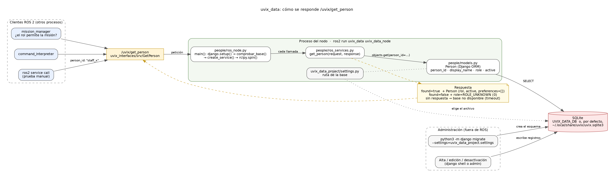
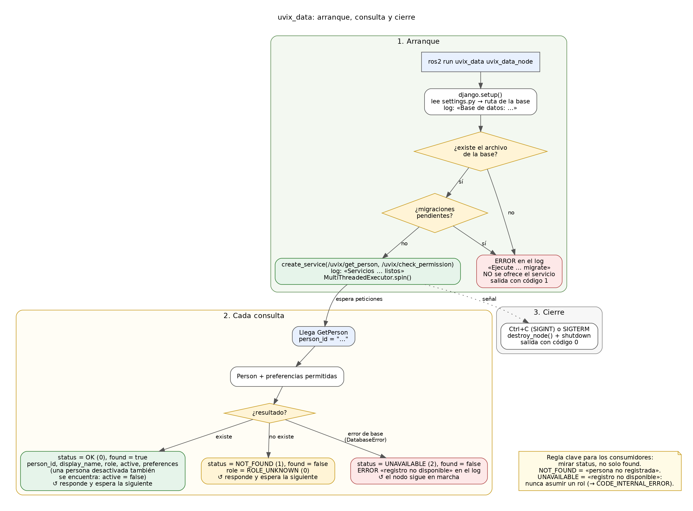

# Cómo funciona `uvix_data` (`/uvix/get_person`)

Este documento explica qué hace el paquete, qué piezas tiene y qué ocurre en el
arranque, en cada consulta y en el cierre. Para compilar y probar, ver el
[README](README.md). Para la evidencia de las pruebas, ver
[la validación M1-05](../../docs/m1_05_validacion_datos_personas.md).

## 1. Para qué sirve

Otros módulos de UVIX necesitan saber **quién es una persona registrada y qué
rol tiene**. Por ejemplo, el `mission_manager` usa el rol para decidir si una
misión está permitida. `uvix_data` guarda ese registro en una base SQLite y lo
ofrece por ROS 2 mediante un único servicio:

```
/uvix/get_person   (uvix_interfaces/srv/GetPerson)
  petición:  string person_id
  respuesta: uint8 status                    # 0 OK, 1 NOT_FOUND, 2 UNAVAILABLE
             bool found                      # true solo con OK (compatibilidad)
             uvix_interfaces/Person person   # person_id, display_name, role, active, preferences
```

## 2. Piezas y recorrido de una consulta



Cómo leer el diagrama, de izquierda a derecha:

1. **Clientes.** El `mission_manager`, el `command_interpreter` o un
   `ros2 service call` de prueba envían un `person_id` al servicio. Son procesos
   distintos y solo se comunican por ROS 2.
2. **Nodo.** `ros2 run uvix_data uvix_data_node` ejecuta `people/ros_node.py`.
   Ese archivo prepara Django, comprueba la base, crea el servicio y queda
   esperando peticiones (`rclpy.spin()`).
3. **Callback.** En cada petición, `people/ros_services.py::get_person` busca la
   persona por `person_id`. No hay caché: cada consulta lee la base.
4. **Modelo.** `people/models.py::Person` es la tabla `people_person`, con los
   campos `person_id` (único), `display_name`, `role` (0–3) y `active`. Django
   traduce la búsqueda a un `SELECT`.
5. **Base SQLite.** `settings.py` decide qué archivo usar:
   `UVIX_DATA_DB` si está definida y, si no,
   `~/.local/share/uvix/uvix.sqlite3`.
6. **Administración, fuera de ROS.** El esquema se crea con
   `python3 -m django migrate`. Las personas se dan de alta, se editan o se
   desactivan con `django shell` o con el admin de Django. El nodo **solo lee**.

### Tabla de equivalencias entre la base y el mensaje

| Base (`Person`) | Mensaje (`uvix_interfaces/Person`) |
|---|---|
| `person_id` | `person_id` |
| `display_name` | `display_name` |
| `role` 0 / 1 / 2 / 3 | `ROLE_UNKNOWN` / `ROLE_PATIENT` / `ROLE_STAFF` / `ROLE_ADMIN` |
| `active` | `active` |
| `PersonPreference` (claves permitidas, ordenadas) | `preferences`: vacío si la persona no tiene preferencias |

Permisos (`/uvix/check_permission`) y plantillas faciales (`/uvix/enroll_face`):
ver el [README](README.md) §3–§6.

## 3. Arranque, consulta y cierre



### 3.1 Arranque

1. `django.setup()` carga `settings.py`, y con ello la ruta de la base. El log
   la muestra: `Base de datos: …`.
2. **¿Existe el archivo?** Si no existe, el nodo no lo crea vacío: escribe
   `ERROR … Ejecute 'python3 -m django migrate …'` y termina con código 1.
3. **¿Hay migraciones pendientes?** Si el esquema está incompleto (por ejemplo,
   un archivo vacío), el error es el mismo y también termina con código 1.
4. Si todo está bien, crea `/uvix/get_person`, escribe
   `Servicio /uvix/get_person listo` y espera peticiones.

Gracias a estas comprobaciones, **el servicio solo aparece si puede responder de
verdad**.

### 3.2 Cada consulta

| Situación | Respuesta | Qué debe entender el cliente |
|---|---|---|
| `person_id` registrado y activo | `status=OK`, `found=true`, datos completos, `active=true` | Persona conocida con ese rol |
| `person_id` registrado pero desactivado | `status=OK`, `found=true`, mismo nombre y rol, `active=false` | Se sabe quién es, pero **no puede autorizar** operaciones nuevas |
| `person_id` desconocido (o vacío) | `status=NOT_FOUND`, `found=false`, `role=ROLE_UNKNOWN` | Persona no registrada → sin permisos |
| Error de la base (tabla inaccesible, archivo dañado…) | `status=UNAVAILABLE`, `found=false`; `ERROR … registro no disponible` en el log; el nodo **sigue en marcha** | Registro no disponible → **nunca asumir un rol** (`CODE_INTERNAL_ERROR`) |

Lo importante es la diferencia entre las dos últimas filas: `NOT_FOUND` es una
respuesta válida ("no está registrada"); `UNAVAILABLE` significa que no se pudo
consultar. Por eso los clientes deben mirar `status` y no solo `found`.

> Historia: hasta M1-05 el contrato solo tenía `found` y, ante un error de base,
> el nodo se detenía sin responder para no confundirlo con "no registrada"
> (hallazgo H1). Con `status` (convención del issue #60) responde `UNAVAILABLE`
> y se recupera solo cuando la base vuelve a estar disponible.

### 3.3 Cierre

Ctrl+C (SIGINT) y SIGTERM (lo que envían `ros2 launch` o systemd) cierran el
nodo de forma ordenada: `destroy_node()` y `shutdown`, con código 0. Como los
datos están en SQLite, al volver a arrancar se recuperan los mismos registros.

## 4. Archivos del paquete

| Archivo | Papel |
|---|---|
| `people/ros_node.py` | Punto de entrada (`uvix_data_node`): arranque, comprobaciones, servicio, cierre |
| `people/ros_services.py` | Callback `get_person`: base → mensaje |
| `people/models.py` | Modelo `Person` y roles |
| `people/migrations/` | Esquema de la base |
| `people/admin.py` | Administración de personas desde el admin de Django |
| `people/tests.py` | Pruebas unitarias del callback |
| `uvix_data_project/settings.py` | Configuración de Django y ruta de la base (`UVIX_DATA_DB`) |
| `test/validar_get_person.py` | Prueba de extremo a extremo con `ros2 run` |
| `test/medir_get_person.py` | Mediciones de RAM, CPU y latencia |
| `imagenes/*.dot` → `*.png` | Fuentes de los diagramas: `dot -Tpng -Gdpi=150 X.dot -o X.png` |

## 5. Cifras de referencia (PC de desarrollo)

Valores medidos en un Ryzen 7 5800H con WSL2 y Cyclone DDS:

- **RAM:** unos 69 MiB tras el arranque. Con `DEBUG=True` sube hasta unos 75 MiB
  y se estabiliza después de unas 9000 consultas.
- **CPU en reposo:** prácticamente cero.
- **Latencia por consulta:** mediana de unos 1.7–2.3 ms.

Las mediciones en la Jetson están pendientes.
