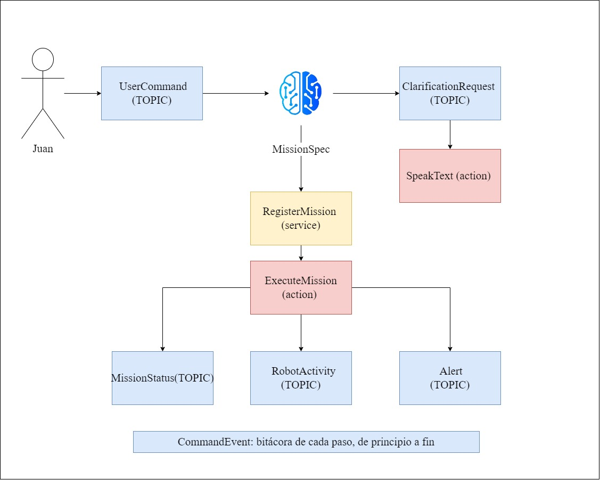
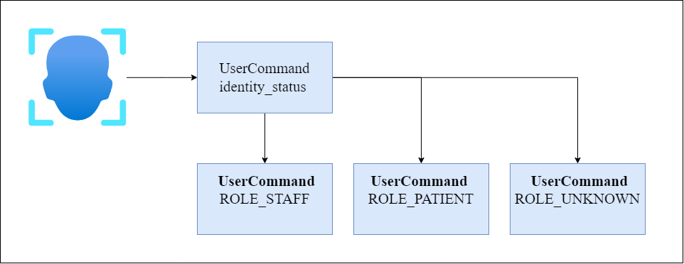
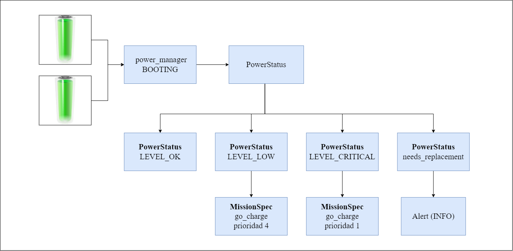

# uvix_interfaces

Mensajes, servicios y acciones de ROS 2 del robot social-asistencial **UVIX**.
Este paquete solo define interfaces; la lógica vive en `command_interpreter`,
`mission_manager` y el resto de paquetes.

El catálogo de capacidades, los identificadores y los requisitos de modelos del
hito M1 están en [`docs/m1_interfaces.md`](../../docs/m1_interfaces.md).

**Contenido**

1. [Idea de funcionamiento](#1-idea-de-funcionamiento)
2. [Flujo de una orden](#2-flujo-de-una-orden)
3. [Identificación de personas](#3-identificación-de-personas)
4. [Arranque y salud del sistema](#4-arranque-y-salud-del-sistema)
5. [Baterías y carga](#5-baterías-y-carga)
6. [Ejemplos YAML](#6-ejemplos-yaml)
7. [Inventario de interfaces](#7-inventario-de-interfaces)

---

## 1. Idea de funcionamiento

UVIX recibe órdenes de **personas registradas** y también actúa por su cuenta
cuando **detecta algo** (por ejemplo, una caída). Cada tarea se convierte en una
**misión** con un **origen** y una **prioridad**. El `mission_manager` decide qué se
ejecuta, qué espera y qué se interrumpe.

### 1.1 Orígenes y prioridades

| Prioridad | Nombre | Quién la origina | Ejemplos | ¿Interrumpe a otras? |
|---|---|---|---|---|
| **1** | `PRIORITY_EMERGENCY` | `ORIGIN_DETECTION` (el robot) o `ORIGIN_PATIENT` | Caída detectada, paciente pide ayuda | Sí, a todas, de inmediato |
| **2** | `PRIORITY_CARE` | `ORIGIN_STAFF` (encargado, asistente, doctor) o `ORIGIN_SCHEDULE` | Dispensar vitaminas, encargos a personas, rondas de recordatorio | No interrumpe; espera turno. Puede pausarse brevemente por una social |
| **3** | `PRIORITY_SOCIAL` | `ORIGIN_PATIENT` | Bailar, conversar, recordatorio a un encargado u otro paciente | Solo pausa una de prioridad 2 si esta es `interruptible`, y por un tiempo limitado (`max_duration_s`) |
| **4** | `PRIORITY_BACKGROUND` | `ORIGIN_SYSTEM` | Ir a cargar, rondas sin urgencia | No |

Con batería `LEVEL_CRITICAL`, la misión `go_charge` se registra con prioridad 1
(ver [sección 5](#5-baterías-y-carga)).

### 1.2 Quién puede pedir qué

| Rol (`Person.role`) | Puede pedir | Resultado si no puede |
|---|---|---|
| `ROLE_UNKNOWN` (no registrado) | Nada | `CODE_NOT_AUTHORIZED`; el robot no obedece |
| Identidad sin verificar (`IDENTITY_CANDIDATE`) | Solo pedir ayuda (emergencia) | `CODE_IDENTITY_NOT_VERIFIED` para el resto |
| `ROLE_PATIENT` | Ayuda (P1), bailar, conversar, recordatorios (P3) | `CODE_NOT_AUTHORIZED` si pide una tarea de cuidado |
| `ROLE_STAFF` | Tareas de cuidado (P2) y todo lo de paciente | — |
| `ROLE_ADMIN` | Todo, incluida configuración | — |

**La prioridad la fija siempre el `mission_manager`** según tipo de misión + rol;
nunca el solicitante. Una petición de ayuda de un paciente cambia a P1 aunque el
origen sea `ORIGIN_PATIENT`.

### 1.3 Catálogo de misiones (`MissionSpec.mission_type`)

Cada tipo existe como constante de texto en `MissionSpec` (`TYPE_DANCE = "dance"`, etc.).
El `mission_manager` rechaza cualquier otro valor con `CODE_UNKNOWN_MISSION_TYPE`.

| `mission_type` | Prioridad | Parámetros (`KeyValue`) | Si falla |
|---|---|---|---|
| `attend_fall` | 1 | `track_id` | `Alert` EMERGENCY al personal |
| `attend_help_request` | 1 | — | `Alert` EMERGENCY al personal |
| `dispense_vitamins` | 2 | `item`, `dose` | `STATE_PARTIAL` + informe a `report_to` |
| `deliver_item` | 2 | `item` | Informe a `report_to` |
| `reminder_round` | 2 o 3 | `message` | `STATE_PARTIAL` + informe con los no encontrados |
| `dance` | 3 | `song` | — |
| `chat` | 3 | — | — |
| `go_charge` | 4 (1 si crítica) | — | `SystemStatus` DEGRADED |

Un recordatorio es P2 si lo ordena personal (o es programado) y P3 si lo pide un paciente.

### 1.4 Reglas de interrupción

1. **Emergencia**: pausa la misión actual (`STATE_PAUSED`), se atiende y luego se
   reanuda la pausada si sigue siendo válida.
2. **Interacción social durante una tarea de cuidado**: si la misión en curso es
   `interruptible`, el robot puede atender al paciente durante `max_duration_s`
   (p. ej. 60–120 s). Al terminar el tiempo se despide y reanuda la tarea.
   Si no es `interruptible`, responde que vuelve más tarde y encola la petición.
3. **Dos misiones de igual prioridad**: orden de llegada; el `deadline` desempata.
4. **Persona no encontrada** tras buscar en todas las zonas: la misión termina en
   `STATE_PARTIAL` o `STATE_FAILED` con `CODE_PERSON_NOT_FOUND` y, si
   `report_on_failure`, se publica un `Alert` `LEVEL_INFO`/`LEVEL_WARNING` para `report_to`.
5. Una misión pausada publica `STATE_PAUSED` con `code: CODE_PREEMPTED` y
   `preempted_by` = `mission_id` de la misión que la interrumpió.
6. **Misiones programadas** (`ORIGIN_SCHEDULE`) quedan en `STATE_QUEUED` hasta
   `start_time`; si pasa el `deadline` sin terminar → `CODE_TIMEOUT`.
7. **Cancelar**: el personal (o quien la pidió) usa `CancelMission`. Una emergencia
   en curso no se puede cancelar (`CODE_NOT_CANCELABLE`).
8. **Emergencias con confirmación**: los `Alert` con `requires_ack: true` se
   repiten hasta que alguien del personal llama a `AckAlert`.

### 1.5 Verificación de identidad

Saber que Juan es cuidador **no demuestra** que quien habla sea Juan. Por eso el
manager nunca autoriza solo con `requested_by`: pide la verificación de identidad
de esa petición (`request_id`) al componente de identificación y luego consulta el
rol en el registro. Detalle en la [sección 3](#3-identificación-de-personas).

---

## 2. Flujo de una orden



Ejemplo: **Juan** (encargado) dice *"Dale las vitaminas a María y a Pedro"*.

| Paso | Interfaz | Tipo | Qué pasa |
|---|---|---|---|
| 1 | `UserCommand` | topic | La voz se convierte en texto y se publica con `request_id`, idioma, confianza e identidad del hablante. |
| 2 | `command_interpreter` | nodo | Entiende la orden y arma un `MissionSpec` (`mission_type: dispense_vitamins`, objetivos `María`, `Pedro`). |
| 2b | `ClarificationRequest` → `SpeakText` | topic → action | Si falta algo (¿qué vitamina?) publica la pregunta y el robot la dice en voz alta. La respuesta del usuario vuelve a entrar como un **nuevo `UserCommand`** (nuevo `request_id`, mismo `session_id`, `parent_request_id` = orden original). Ver [identificadores](../../docs/m1_interfaces.md#33-respuesta-a-una-aclaración). |
| 3 | `RegisterMission` | service | El `mission_manager` valida tipo y parámetros, **verifica la identidad** (`GetRequestIdentity`) y el rol (`GetPerson`), **asigna la prioridad** y responde `accepted` + `mission_id`, o un código de rechazo. |
| 4 | `ExecuteMission` | action | Cuando le toca el turno, la misión se ejecuta con feedback de progreso. Se puede cancelar. |
| 5 | `MissionStatus` | topic | Estado de la misión: en cola, ejecutando, pausada, parcial, completada… |
| 5 | `RobotActivity` | topic | Qué está haciendo el robot ahora mismo: navegando, buscando a María, conversando… |
| 5 | `Alert` | topic | Emergencias e informes (p. ej. "no encontré a Pedro"). |
| — | `CommandEvent` | topic | **Bitácora**: cada nodo publica un evento en cada paso (`RECEIVED`, `INTERPRETED`, `REGISTERED`, `EXECUTING`, `COMPLETED`…), todos con el mismo `request_id`. Sirve para depurar y auditar. |

Las detecciones del robot (caídas) **no pasan por `UserCommand`**: el detector
llama directamente a `RegisterMission` con `origin: ORIGIN_DETECTION`.

---

## 3. Identificación de personas



### 3.1 Tres datos distintos

| Dato | Pregunta que responde | Dónde vive | Quién lo produce |
|---|---|---|---|
| `person_id` | ¿Qué persona se está identificando? | `IdentityVerification` | Componente de identificación |
| `identity_status` | ¿Se verificó que realmente es esa persona? | `IdentityVerification` | Componente de identificación |
| `role` | ¿Qué permisos tiene esa persona registrada? | `Person` (registro) | Registro de personas (`GetPerson`) |

`MissionSpec.requested_by` es solo lo **declarado** por el `command_interpreter`;
no autoriza nada por sí solo. `UserCommand.identity_status` / `person_id` son una
**pista informativa** (para saludar o pedir que la persona se acerque a la cámara),
tampoco sirven para autorizar.

### 3.2 Flujo de verificación

```
 cámara / voz / tarjeta
        │
        ▼
 componente de identificación ──(guarda por request_id)──► IdentityVerification
        ▲                                                     │
        │ GetRequestIdentity(request_id)                      │
        │                                                     ▼
 mission_manager ◄── RegisterMission(MissionSpec con request_id y requested_by)
        │
        └── GetPerson(person_id verificado) ──► role
```

Cuando el manager recibe `RegisterMission`, `CancelMission` o `AckAlert`:

| # | Comprobación | Si falla |
|---|---|---|
| 1 | Llama a `GetRequestIdentity(request_id)`: ¿existe la verificación? | `CODE_IDENTITY_NOT_VERIFIED` |
| 2 | ¿`identity_status == IDENTITY_VERIFIED`? (`CANDIDATE` es solo una hipótesis) | `CODE_IDENTITY_NOT_VERIFIED`* |
| 3 | ¿`ahora <= valid_until`? | `CODE_IDENTITY_EXPIRED` |
| 4 | ¿`identity.person_id == requested_by`? | `CODE_IDENTITY_MISMATCH` |
| 5 | ¿El `request_id` no se usó ya para otra misión? | `CODE_DUPLICATE_REQUEST` |
| 6 | `GetPerson(identity.person_id)` → ¿el `role` permite este `mission_type`? | `CODE_NOT_AUTHORIZED` |

\* **Excepción de emergencia:** `attend_help_request` se acepta con
`IDENTITY_CANDIDATE`, porque es preferible atender una falsa alarma a ignorar a
alguien que pide ayuda.

### 3.3 Disponibilidad y validez de la verificación

- **Quién la produce:** solo el componente de identificación. El
  `command_interpreter` nunca rellena `IdentityVerification`; solo copia el
  `request_id`.
- **Cuánto dura:** `valid_until` = momento de la verificación + un tiempo corto
  (p. ej. 60 s, parámetro `verification_ttl_s`). Pasado ese tiempo hay que volver
  a verificar; así una orden no se ejecuta con la identificación de alguien que
  ya se fue.
- **Dónde se guarda:** el componente guarda las verificaciones por `request_id`
  y borra las caducadas. Si el manager la pide tarde, recibe `found: false`.
- **Un solo uso:** cada `request_id` autoriza **una** misión
  (`CODE_DUPLICATE_REQUEST` si se reutiliza).
- **Misiones largas o programadas:** la identidad se verifica **al registrar**. Una
  vez aceptada, la misión no necesita que la persona siga delante del robot.
- **Cancelar y confirmar alertas:** son acciones nuevas, así que llevan su propio
  `request_id` y se verifican igual.
- **Orígenes internos** (`DETECTION`, `SCHEDULE`, `SYSTEM`): no tienen persona que
  verificar. Las crean nodos del propio robot; solo esos nodos pueden llamar a
  `RegisterMission` con esos orígenes (p. ej. restringido con SROS2).

### 3.4 Rol y permisos

Con el `person_id` **verificado**, el manager consulta el rol con `GetPerson`
(que lee [`personas.yaml`](#65-registro-de-personas-personasyaml)) y aplica la
tabla [1.2](#12-quién-puede-pedir-qué):

- `ROLE_STAFF` / `ROLE_ADMIN` → tareas de cuidado y sociales.
- `ROLE_PATIENT` → ayuda y tareas sociales.
- `ROLE_UNKNOWN` o no registrado → `CODE_NOT_AUTHORIZED`.

---

## 4. Arranque y salud del sistema


| Estado `SystemStatus` | Significado | Qué hace el `mission_manager` |
|---|---|---|
| `BOOTING` | Los nodos están arrancando | Rechaza todo (`CODE_BUSY`) |
| `SELF_CHECK` | Revisa `/diagnostics` (sensores, motores, cámara, micrófono) | Rechaza todo (`CODE_BUSY`) |
| `READY` | Todo correcto | Acepta misiones |
| `DEGRADED` | Funciona con limitaciones; `failed_components` dice qué falla | Publica `Alert` WARNING; acepta solo las misiones que no dependen del componente caído |
| `ERROR` | No puede operar con seguridad | Publica `Alert` y rechaza todo |
| `SHUTTING_DOWN` | Apagándose | Cancela misiones en curso |

---

## 5. Baterías y carga



El `power_manager` lee las dos baterías (`sensor_msgs/BatteryState`) y publica un
único `PowerStatus`:

| Condición | Acción |
|---|---|
| `LEVEL_OK` | Nada |
| `LEVEL_LOW` | Registra `MissionSpec` `go_charge`, **prioridad 4**: irá a cargar cuando no tenga nada más que hacer |
| `LEVEL_CRITICAL` | Registra `go_charge`, **prioridad 1**: pausa lo que esté haciendo y va a cargar |
| `needs_replacement` | Publica `Alert` `LEVEL_INFO` al administrador (cambiar batería) |

---

## 6. Ejemplos YAML

Los ejemplos se pueden guardar en archivos `.yaml` y enviarse con
`ros2 topic pub`, `ros2 service call` o `ros2 action send_goal`:

```bash
ros2 service call /uvix/register_mission uvix_interfaces/srv/RegisterMission "$(cat dispensar_vitaminas.yaml)"
```

`stamp: now` lo rellena `ros2` con la hora actual. Los tiempos en cero
(`{sec: 0, nanosec: 0}`) significan "sin valor". Los campos numéricos usan las
constantes de cada mensaje; la tabla [Constantes usadas](#67-constantes-usadas)
indica qué significa cada valor.

### 6.1 Órdenes (`UserCommand`, `IdentityVerification`, `ClarificationRequest`, `CommandEvent`)

**`UserCommand`**: un encargado da una orden por voz (orden nueva, sin `parent_request_id`).

```yaml
header: {stamp: now, frame_id: ''}
request_id: req-0001
parent_request_id: ''
session_id: ses-0001
utterance_id: utt-0001
modality: 2
raw_text: "dale las vitaminas a maría y pedro"
text: "dar vitaminas a María y Pedro"
language: es
confidence: 0.92
identity_status: 2
person_id: staff_juan
track_id: track-17
```

**`IdentityVerification`**: lo que guarda el componente de identificación para
`req-0001`, verificado por cara y voz, válido 60 s.

```yaml
header: {stamp: now, frame_id: ''}
request_id: req-0001
person_id: staff_juan
identity_status: 2
method: 3
confidence: 0.97
track_id: track-17
verifier: face_id_node
valid_until: {sec: 1795000060, nanosec: 0}
```

**`GetRequestIdentity`**: petición del manager al registrar la misión.

```yaml
request_id: req-0001
```

Respuesta con una identidad solo candidata (por voz); una misión de cuidado se rechazaría:

```yaml
found: true
identity:
  header: {stamp: {sec: 1795000000, nanosec: 0}, frame_id: ''}
  request_id: req-0001
  person_id: staff_juan
  identity_status: 1
  method: 2
  confidence: 0.61
  track_id: ''
  verifier: voice_id_node
  valid_until: {sec: 1795000060, nanosec: 0}
```

**`UserCommand`**: una persona no registrada (se rechazará).

```yaml
header: {stamp: now, frame_id: ''}
request_id: req-0002
parent_request_id: ''
session_id: ''
utterance_id: utt-0002
modality: 2
raw_text: "ven aquí"
text: "ven aquí"
language: es
confidence: 0.85
identity_status: 0
person_id: ''
track_id: track-21
```

**`ClarificationRequest`**: falta indicar qué vitamina.

```yaml
header: {stamp: now, frame_id: ''}
request_id: req-0001
session_id: ses-0001
reason: 2
question: "¿Qué vitamina les doy, C o D?"
missing_key: item
options: [vitamina_c, vitamina_d]
timeout_s: 20.0
```

**`CommandEvent`**: la misión fue registrada.

```yaml
header: {stamp: now, frame_id: ''}
event_id: evt-0003
request_id: req-0001
mission_id: mis-0042
source: mission_manager
state: 4
code: 0
detail: "Misión registrada con prioridad 2"
```

**`CommandEvent`**: la orden fue rechazada por venir de una persona no registrada.

```yaml
header: {stamp: now, frame_id: ''}
event_id: evt-0010
request_id: req-0002
mission_id: ''
source: mission_manager
state: 5
code: 4
detail: "Persona no registrada"
```

### 6.2 Misiones (`RegisterMission`)

En la petición, `mission_id` va vacío y `priority: 0`: el manager asigna ambos.

**Dispensar vitaminas** (personal, P2, interrumpible, empieza ya): `dispensar_vitaminas.yaml`

```yaml
mission:
  mission_id: ''
  mission_type: dispense_vitamins
  description: "Vitamina C a María y Pedro"
  origin: 1
  request_id: req-0001
  requested_by: staff_juan
  target_person_ids: [patient_maria, patient_pedro]
  target_location: ''
  priority: 0
  interruptible: true
  max_duration_s: 0.0
  start_time: {sec: 0, nanosec: 0}
  deadline: {sec: 0, nanosec: 0}
  report_on_failure: true
  report_to: staff_juan
  parameters:
    - {key: item, value: vitamina_c}
    - {key: dose, value: '1'}
```

**Ronda de recordatorio programada** (horario, P2): empieza a las 14:30 y debe
terminar antes de la terapia de las 15:00.

```yaml
mission:
  mission_id: ''
  mission_type: reminder_round
  description: "Recordar la terapia de las 15:00"
  origin: 4
  request_id: ''
  requested_by: ''
  target_person_ids: [patient_maria, patient_pedro, patient_luis]
  target_location: ''
  priority: 0
  interruptible: true
  max_duration_s: 0.0
  start_time: {sec: 1795012200, nanosec: 0}
  deadline: {sec: 1795014000, nanosec: 0}
  report_on_failure: true
  report_to: staff_ana
  parameters:
    - {key: message, value: "La terapia empieza a las 15:00 en la sala 2"}
```

**Bailar** (paciente, P3, máximo 2 minutos):

```yaml
mission:
  mission_id: ''
  mission_type: dance
  description: "María pidió bailar"
  origin: 2
  request_id: req-0007
  requested_by: patient_maria
  target_person_ids: [patient_maria]
  target_location: ''
  priority: 0
  interruptible: true
  max_duration_s: 120.0
  start_time: {sec: 0, nanosec: 0}
  deadline: {sec: 0, nanosec: 0}
  report_on_failure: false
  report_to: ''
  parameters:
    - {key: song, value: cumbia_01}
```

**Caída detectada** (robot, P1, no interrumpible). Si no se reconoce a la
persona, `target_person_ids` va vacío.

```yaml
mission:
  mission_id: ''
  mission_type: attend_fall
  description: "Caída detectada en pasillo B"
  origin: 3
  request_id: ''
  requested_by: ''
  target_person_ids: [patient_pedro]
  target_location: pasillo_b
  priority: 0
  interruptible: false
  max_duration_s: 0.0
  start_time: {sec: 0, nanosec: 0}
  deadline: {sec: 0, nanosec: 0}
  report_on_failure: true
  report_to: staff_ana
  parameters:
    - {key: track_id, value: track-17}
```

**Respuestas** del servicio.

Aceptada:

```yaml
accepted: true
code: 0
mission_id: mis-0042
message: "Registrada con prioridad 2; en cola detrás de 0 misiones"
```

Rechazada porque un paciente verificado pide dispensar vitaminas:

```yaml
accepted: false
code: 4
mission_id: ''
message: "dispense_vitamins requiere ROLE_STAFF"
```

Rechazada porque "Juan" solo fue identificado por voz (`IDENTITY_CANDIDATE`):

```yaml
accepted: false
code: 5
mission_id: ''
message: "Identidad no verificada; acérquese a la cámara"
```

Rechazada porque la verificación caducó antes de registrar:

```yaml
accepted: false
code: 9
mission_id: ''
message: "Verificación de req-0001 vencida; repita la orden"
```

Rechazada porque `requested_by` no coincide con la persona verificada:

```yaml
accepted: false
code: 10
mission_id: ''
message: "requested_by=staff_juan pero se verificó a patient_pedro"
```

### 6.3 Ejecución (`ExecuteMission`, `MissionStatus`, `RobotActivity`, `Alert`, `AckAlert`, `CancelMission`, `GetPerson`, `SpeakText`)

**`ExecuteMission`**: feedback durante la ejecución.

```yaml
state: 2
current_step: "Buscando a patient_pedro"
progress: 0.5
```

**`ExecuteMission`**: resultado final parcial (Pedro no fue encontrado; `success`
solo es `true` cuando el estado es `STATE_COMPLETED`).

```yaml
success: false
state: 5
code: 20
detail: "patient_pedro no encontrado"
completed_targets: [patient_maria]
failed_targets: [patient_pedro]
```

**`MissionStatus`**: terminó parcial (no encontró a Pedro).

```yaml
header: {stamp: now, frame_id: ''}
mission_id: mis-0042
mission_type: dispense_vitamins
state: 5
code: 20
detail: "patient_pedro no encontrado tras recorrer todas las zonas"
preempted_by: ''
progress: 1.0
current_target: ''
completed_targets: [patient_maria]
failed_targets: [patient_pedro]
started: {sec: 1795000000, nanosec: 0}
finished: {sec: 1795000600, nanosec: 0}
```

**`MissionStatus`**: pausada por la misión de caída `mis-0050`.

```yaml
header: {stamp: now, frame_id: ''}
mission_id: mis-0042
mission_type: dispense_vitamins
state: 3
code: 21
detail: "Pausada por emergencia"
preempted_by: mis-0050
progress: 0.5
current_target: ''
completed_targets: [patient_maria]
failed_targets: []
started: {sec: 1795000000, nanosec: 0}
finished: {sec: 0, nanosec: 0}
```

**`RobotActivity`**: buscando a un paciente durante una misión de cuidado.

```yaml
header: {stamp: now, frame_id: ''}
mode: 1
mission_id: mis-0042
mission_type: dispense_vitamins
target_person_id: patient_pedro
activity: 2
description: "Revisando habitación 3"
```

**`RobotActivity`**: bailando durante una interacción social.

```yaml
header: {stamp: now, frame_id: ''}
mode: 2
mission_id: mis-0043
mission_type: dance
target_person_id: patient_maria
activity: 7
description: "Bailando con María (quedan 80 s)"
```

**`Alert`**: emergencia por caída; se repite hasta recibir `AckAlert`.

```yaml
header: {stamp: now, frame_id: map}
alert_id: alt-0100
level: 2
mission_id: mis-0050
about_person_id: patient_pedro
notify_person_id: staff_ana
location: pasillo_b
text: "Caída detectada. Pedro en el suelo, no responde."
requires_ack: true
```

**`Alert`**: informe de persona no encontrada.

```yaml
header: {stamp: now, frame_id: ''}
alert_id: alt-0101
level: 1
mission_id: mis-0042
about_person_id: patient_pedro
notify_person_id: staff_juan
location: ''
text: "No encontré a Pedro para darle la vitamina C."
requires_ack: false
```

**`AckAlert`**: Ana, verificada con `req-0031`, confirma que atendió la caída.

```yaml
alert_id: alt-0100
request_id: req-0031
acknowledged_by: staff_ana
note: "Pedro atendido, sin lesiones"
```

**`CancelMission`**: Juan, verificado con `req-0040`, cancela la entrega de vitaminas.

```yaml
mission_id: mis-0042
request_id: req-0040
requested_by: staff_juan
reason: "María ya tomó la vitamina en el desayuno"
```

Respuesta:

```yaml
accepted: true
code: 0
message: "Misión mis-0042 cancelada"
```

**`GetPerson`**: consultar el rol de una persona.

```yaml
person_id: staff_juan
```

Respuesta:

```yaml
found: true
person: {person_id: staff_juan, display_name: Juan, role: 2}
```

**`SpeakText`**: objetivo de la acción.

```yaml
text: "Hola María, aquí está tu vitamina C."
language: es
request_id: req-0001
interruptible: true
```

### 6.4 Estado del robot (`SystemStatus`, `PowerStatus`)

**`SystemStatus`**: funcionando con la cámara frontal caída.

```yaml
header: {stamp: now, frame_id: ''}
state: 4
failed_components: [camera_front]
detail: "Sin cámara frontal: no puede identificar personas"
```

**`PowerStatus`**: batería baja. `batteries` lleva un `sensor_msgs/BatteryState`
por batería.

```yaml
header: {stamp: now, frame_id: ''}
batteries: []
charge_cycles: [312, 298]
total_percentage: 0.18
estimated_runtime_s: 1500.0
level: 2
docked: false
charging: false
needs_charge: true
needs_replacement: false
```

### 6.5 Registro de personas (`personas.yaml`)

Archivo de datos que carga el nodo que sirve `GetPerson` para mapear `person_id` → `Person`.
No es un archivo de parámetros de ROS (contiene listas de objetos).

```yaml
personas:
  - person_id: staff_juan
    display_name: Juan
    role: 2
  - person_id: staff_ana
    display_name: Ana
    role: 2
  - person_id: patient_maria
    display_name: María
    role: 1
  - person_id: patient_pedro
    display_name: Pedro
    role: 1
  - person_id: admin_chino
    display_name: Administrador
    role: 3
```

### 6.6 Parámetros de nodos (`config/*.yaml`)

**`mission_manager.yaml`**

| Parámetro | Significado |
|---|---|
| `social_max_duration_s` | Tiempo máximo de baile o charla |
| `search_timeout_s` | Cuánto buscar a una persona antes de darla por no encontrada |
| `clarification_timeout_s` | Espera máxima de la respuesta a una aclaración |
| `default_report_to` | Destinatario del informe si la misión no indica `report_to` |
| `priorities` | Prioridad de cada `mission_type` |
| `min_role` | Rol mínimo para pedir cada `mission_type` |

```yaml
mission_manager:
  ros__parameters:
    personas_file: personas.yaml
    social_max_duration_s: 120.0
    search_timeout_s: 600.0
    clarification_timeout_s: 20.0
    default_report_to: staff_ana
    priorities:
      attend_fall: 1
      attend_help_request: 1
      dispense_vitamins: 2
      deliver_item: 2
      reminder_round_staff: 2
      reminder_round_patient: 3
      dance: 3
      chat: 3
      go_charge: 4
    min_role:
      attend_help_request: 1
      dispense_vitamins: 2
      deliver_item: 2
      reminder_round: 1
      dance: 1
      chat: 1
```

**`identity_manager.yaml`** (componente de identificación)

| Parámetro | Significado |
|---|---|
| `verification_ttl_s` | Vigencia de una verificación: `valid_until` = verificación + este tiempo |
| `min_confidence_verified` | Por debajo de esta confianza la identidad queda en `IDENTITY_CANDIDATE` |
| `accepted_methods` | Métodos que pueden dar `IDENTITY_VERIFIED`: cara, cara y voz, tarjeta (solo voz no basta) |
| `cleanup_period_s` | Cada cuánto se borran las verificaciones caducadas |

```yaml
identity_manager:
  ros__parameters:
    verification_ttl_s: 60.0
    min_confidence_verified: 0.90
    accepted_methods: [1, 3, 4]
    cleanup_period_s: 10.0
```

**`power_manager.yaml`**

| Parámetro | Significado |
|---|---|
| `low_threshold` | Por debajo de este porcentaje → `LEVEL_LOW` |
| `critical_threshold` | Por debajo de este porcentaje → `LEVEL_CRITICAL` |
| `max_charge_cycles` | A partir de estos ciclos → `needs_replacement` |
| `publish_rate_hz` | Frecuencia de publicación de `PowerStatus` |

```yaml
power_manager:
  ros__parameters:
    low_threshold: 0.25
    critical_threshold: 0.10
    max_charge_cycles: 500
    publish_rate_hz: 1.0
```

### 6.7 Constantes usadas

| Campo | Valor | Constante |
|---|---|---|
| `UserCommand.modality` | 2 | `MODALITY_VOICE` |
| `identity_status` | 0 / 1 / 2 | `IDENTITY_UNKNOWN` / `IDENTITY_CANDIDATE` / `IDENTITY_VERIFIED` |
| `IdentityVerification.method` | 1 / 2 / 3 / 4 | `METHOD_FACE` / `METHOD_VOICE` / `METHOD_FACE_AND_VOICE` / `METHOD_BADGE` |
| `ClarificationRequest.reason` | 2 | `REASON_MISSING_PARAMETER` |
| `CommandEvent.state` | 4 / 5 | `STATE_REGISTERED` / `STATE_REJECTED` |
| `MissionSpec.origin` | 1 / 2 / 3 / 4 | `ORIGIN_STAFF` / `ORIGIN_PATIENT` / `ORIGIN_DETECTION` / `ORIGIN_SCHEDULE` |
| `MissionSpec.priority` | 0 | `PRIORITY_UNSET` |
| `RegisterMission.code` | 0 / 4 / 5 / 9 / 10 | `CODE_OK` / `CODE_NOT_AUTHORIZED` / `CODE_IDENTITY_NOT_VERIFIED` / `CODE_IDENTITY_EXPIRED` / `CODE_IDENTITY_MISMATCH` |
| `MissionStatus.state` | 2 / 3 / 5 | `STATE_EXECUTING` / `STATE_PAUSED` / `STATE_PARTIAL` |
| `MissionStatus.code` | 20 / 21 | `CODE_PERSON_NOT_FOUND` / `CODE_PREEMPTED` |
| `RobotActivity.mode` | 1 / 2 | `MODE_MISSION` / `MODE_SOCIAL` |
| `RobotActivity.activity` | 2 / 7 | `ACTIVITY_SEARCHING_PERSON` / `ACTIVITY_DANCING` |
| `Alert.level` | 1 / 2 | `LEVEL_WARNING` / `LEVEL_EMERGENCY` |
| `SystemStatus.state` | 4 | `STATE_DEGRADED` |
| `PowerStatus.level` | 2 | `LEVEL_LOW` |
| `Person.role` | 1 / 2 / 3 | `ROLE_PATIENT` / `ROLE_STAFF` / `ROLE_ADMIN` |

---

## 7. Inventario de interfaces

### Mensajes (`msg/`)

| Archivo | Para qué sirve |
|---|---|
| `KeyValue.msg` | Par clave/valor para parámetros de misión |
| `UserCommand.msg` | Orden que llega por voz, texto o gesto, con identidad del hablante |
| `ClarificationRequest.msg` | Pregunta al usuario cuando la orden es ambigua o faltan datos |
| `CommandEvent.msg` | Bitácora del ciclo de vida de una orden |
| `MissionSpec.msg` | Definición de una misión: tipo, origen, prioridad, objetivos, horario, informe |
| `MissionStatus.msg` | Estado y progreso de una misión, quién la pausó, pacientes atendidos / no encontrados |
| `Alert.msg` | Emergencias, avisos e informes al personal, con confirmación opcional |
| `Person.msg` | Persona registrada y su rol |
| `RobotActivity.msg` | Modo y actividad actual del robot |
| `SystemStatus.msg` | Salud global del sistema |
| `PowerStatus.msg` | Estado de baterías y necesidad de carga |
| `IdentityVerification.msg` | Quién hizo una petición (`request_id`), si está verificado y hasta cuándo vale |

### Servicios (`srv/`)

| Archivo | Para qué sirve |
|---|---|
| `RegisterMission.srv` | Pide al `mission_manager` aceptar una misión |
| `CancelMission.srv` | Cancela una misión registrada o en curso |
| `AckAlert.srv` | El personal confirma que atendió una alerta |
| `GetPerson.srv` | Devuelve la `Person` (y su rol) de un `person_id` |
| `GetRequestIdentity.srv` | Devuelve la `IdentityVerification` de un `request_id` |

### Acciones (`action/`)

| Archivo | Para qué sirve |
|---|---|
| `ExecuteMission.action` | Ejecuta una misión registrada, con feedback de progreso |
| `SpeakText.action` | Hace hablar al robot (TTS), cancelable |

### Topics, servicios y acciones

| Nombre | Tipo | Publica / sirve |
|---|---|---|
| `/uvix/user_command` | `UserCommand` | Interfaz de voz/texto |
| `/uvix/clarification_request` | `ClarificationRequest` | `command_interpreter` |
| `/uvix/command_events` | `CommandEvent` | Todos los nodos del flujo |
| `/uvix/register_mission` | `RegisterMission` (srv) | `mission_manager` |
| `/uvix/cancel_mission` | `CancelMission` (srv) | `mission_manager` |
| `/uvix/ack_alert` | `AckAlert` (srv) | `mission_manager` |
| `/uvix/get_person` | `GetPerson` (srv) | Registro de personas |
| `/uvix/get_request_identity` | `GetRequestIdentity` (srv) | Componente de identificación |
| `/uvix/execute_mission` | `ExecuteMission` (action) | Ejecutor de misiones |
| `/uvix/mission_status` | `MissionStatus` | `mission_manager` |
| `/uvix/robot_activity` | `RobotActivity` | Ejecutor de misiones |
| `/uvix/alerts` | `Alert` | `mission_manager`, detector de caídas |
| `/uvix/system_status` | `SystemStatus` | Supervisor |
| `/uvix/power_status` | `PowerStatus` | `power_manager` |
| `/uvix/speak` | `SpeakText` (action) | Nodo TTS |
