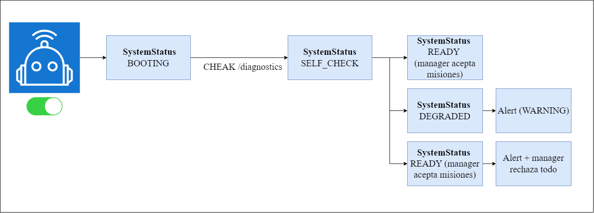

# uvix_interfaces

Mensajes, servicios y acciones de ROS 2 del robot social-asistencial **UVIX**.
Este paquete solo define interfaces; la lógica vive en `command_interpreter`,
`mission_manager` y el resto de paquetes.

> ⚠️ **Estado:** en desarrollo. Los ejemplos de este README usan el diseño
> objetivo (nombre de paquete `uvix_interfaces`, un solo campo `priority`).
> Ver [Anomalías](#7-anomalías-encontradas) para lo que aún no compila.

**Contenido**

1. [Idea de funcionamiento](#1-idea-de-funcionamiento)
2. [Flujo de una orden](#2-flujo-de-una-orden)
3. [Identificación de personas](#3-identificación-de-personas)
4. [Arranque y salud del sistema](#4-arranque-y-salud-del-sistema)
5. [Baterías y carga](#5-baterías-y-carga)
6. [Ejemplos YAML](#6-ejemplos-yaml)
7. [Anomalías encontradas](#7-anomalías-encontradas)
8. [Inventario de interfaces](#8-inventario-de-interfaces)
9. [Compilar](#9-compilar)

---

## 1. Idea de funcionamiento

UVIX recibe órdenes de **personas registradas** y también actúa por su cuenta
cuando **detecta algo** (por ejemplo, una caída). Cada tarea se convierte en una
**misión** con un **origen** y una **prioridad**. El `mission_manager` decide qué se
ejecuta, qué espera y qué se interrumpe.

### 1.1 Orígenes y prioridades

| Prioridad | Nombre | Quién la origina | Ejemplos | ¿Interrumpe a otras? |
|---|---|---|---|---|
| **1** | `PRIORITY_EMERGENCY` | `ORIGIN_DETECTION` (el robot) o `ORIGIN_PATIENT` | Caída detectada, paciente pide ayuda | Sí, a todas, de inmediato |
| **2** | `PRIORITY_CARE` | `ORIGIN_STAFF` (encargado, asistente, doctor) o `ORIGIN_SCHEDULE` | Dispensar vitaminas, encargos a personas, rondas de recordatorio | No interrumpe; espera turno. Puede pausarse brevemente por una social |
| **3** | `PRIORITY_SOCIAL` | `ORIGIN_PATIENT` | Bailar, conversar, recordatorio a un encargado u otro paciente | Solo pausa una de prioridad 2 si esta es `interruptible`, y por un tiempo limitado (`max_duration_s`) |
| **4** | `PRIORITY_BACKGROUND` | `ORIGIN_SYSTEM` | Ir a cargar, rondas sin urgencia | No |

> Batería `LEVEL_CRITICAL` → `go_charge` con prioridad 1 (ver [sección 5](#5-baterías-y-carga)).

### 1.2 Quién puede pedir qué

| Rol (`Person.role`) | Puede pedir | Resultado si no puede |
|---|---|---|
| `ROLE_UNKNOWN` (no registrado) | Nada | `CODE_NOT_AUTHORIZED`; el robot no obedece |
| Identidad sin verificar (`IDENTITY_CANDIDATE`) | Solo pedir ayuda (emergencia) | `CODE_IDENTITY_NOT_VERIFIED` para el resto |
| `ROLE_PATIENT` | Ayuda (P1), bailar, conversar, recordatorios (P3) | `CODE_NOT_AUTHORIZED` si pide una tarea de cuidado |
| `ROLE_STAFF` | Tareas de cuidado (P2) y todo lo de paciente | — |
| `ROLE_ADMIN` | Todo, incluida configuración | — |

**La prioridad la fija siempre el `mission_manager`** según tipo de misión + rol;
nunca el solicitante. Una petición de ayuda de un paciente cambia a P1 aunque el
origen sea `ORIGIN_PATIENT`.

### 1.3 Catálogo de misiones (`MissionSpec.mission_type`)

| `mission_type` | Prioridad | Parámetros (`KeyValue`) | Si falla |
|---|---|---|---|
| `attend_fall` | 1 | `track_id` | `Alert` EMERGENCY al personal |
| `attend_help_request` | 1 | — | `Alert` EMERGENCY al personal |
| `dispense_vitamins` | 2 | `item`, `dose` | `STATE_PARTIAL` + informe a `report_to` |
| `deliver_item` | 2 | `item` | Informe a `report_to` |
| `reminder_round` | 2 o 3 | `message` | `STATE_PARTIAL` + informe con los no encontrados |
| `dance` | 3 | `song` | — |
| `chat` | 3 | — | — |
| `go_charge` | 4 (1 si crítica) | — | `SystemStatus` DEGRADED |

Un recordatorio es P2 si lo ordena personal (o es programado) y P3 si lo pide un paciente.

### 1.4 Reglas de interrupción

1. **Emergencia**: pausa la misión actual (`STATE_PAUSED`), se atiende y luego se
   reanuda la pausada si sigue siendo válida.
2. **Interacción social durante una tarea de cuidado**: si la misión en curso es
   `interruptible`, el robot puede atender al paciente durante `max_duration_s`
   (p. ej. 60–120 s). Al terminar el tiempo se despide y reanuda la tarea.
   Si no es `interruptible`, responde que vuelve más tarde y encola la petición.
3. **Dos misiones de igual prioridad**: orden de llegada; el `deadline` desempata.
4. **Persona no encontrada** tras buscar en todas las zonas: la misión termina en
   `STATE_PARTIAL` o `STATE_FAILED` y, si `report_on_failure`, se publica un
   `Alert` `LEVEL_INFO`/`LEVEL_WARNING` para `report_to`.

---

## 2. Flujo de una orden


Ejemplo: **Juan** (encargado) dice *"Dale las vitaminas a María y a Pedro"*.

| Paso | Interfaz | Tipo | Qué pasa |
|---|---|---|---|
| 1 | `UserCommand` | topic | La voz se convierte en texto y se publica con `request_id`, idioma, confianza e identidad del hablante. |
| 2 | 🧠 `command_interpreter` | nodo | Entiende la orden y arma un `MissionSpec` (`mission_type: dispense_vitamins`, objetivos `María`, `Pedro`). |
| 2b | `ClarificationRequest` → `SpeakText` | topic → action | Si falta algo (¿qué vitamina?) publica la pregunta y el robot la dice en voz alta. La respuesta del usuario vuelve a entrar como un **nuevo `UserCommand` con el mismo `session_id`**. |
| 3 | `RegisterMission` | service | El `mission_manager` valida rol, tipo y parámetros, **asigna la prioridad** y responde `accepted` + `mission_id`, o un código de rechazo. |
| 4 | `ExecuteMission` | action | Cuando le toca el turno, la misión se ejecuta con feedback de progreso. Se puede cancelar. |
| 5 | `MissionStatus` | topic | Estado de la misión: en cola, ejecutando, pausada, parcial, completada… |
| 5 | `RobotActivity` | topic | Qué está haciendo el robot ahora mismo: navegando, buscando a María, conversando… |
| 5 | `Alert` | topic | Emergencias e informes (p. ej. "no encontré a Pedro"). |
| — | `CommandEvent` | topic | **Bitácora**: cada nodo publica un evento en cada paso (`RECEIVED`, `INTERPRETED`, `REGISTERED`, `EXECUTING`, `COMPLETED`…), todos con el mismo `request_id`. Sirve para depurar y auditar. |

Las detecciones del robot (caídas) **no pasan por `UserCommand`**: el detector
llama directamente a `RegisterMission` con `origin: ORIGIN_DETECTION`.

---

## 3. Identificación de personas


1. La cámara/voz identifica a quien habla y lo publica en
   `UserCommand.identity_status` (`UNKNOWN`, `CANDIDATE`, `VERIFIED`) junto con
   su `person_id`.
2. Con el `person_id`, el `mission_manager` busca el **rol** en el registro de
   personas (`Person.role`, ver [`personas.yaml`](#65-registro-de-personas-personasyaml)).
3. Según el rol decide qué puede pedir (tabla [1.2](#12-quién-puede-pedir-qué)):
   - `ROLE_STAFF` → tareas de cuidado y sociales.
   - `ROLE_PATIENT` → ayuda y tareas sociales.
   - `ROLE_UNKNOWN` → se rechaza con `CODE_NOT_AUTHORIZED`.

> En el diagrama aparece `UserCommand ROLE_...`, pero el rol **no** está dentro
> de `UserCommand`: está en `Person`. `UserCommand` solo lleva `identity_status`
> y `person_id`.

---

## 4. Arranque y salud del sistema



| Estado `SystemStatus` | Significado | Qué hace el `mission_manager` |
|---|---|---|
| `BOOTING` | Los nodos están arrancando | Rechaza todo (`CODE_BUSY`) |
| `SELF_CHECK` | Revisa `/diagnostics` (sensores, motores, cámara, micrófono) | Rechaza todo (`CODE_BUSY`) |
| `READY` | Todo correcto | Acepta misiones |
| `DEGRADED` | Funciona con limitaciones; `failed_components` dice qué falla | Publica `Alert` WARNING; acepta solo las misiones que no dependen del componente caído |
| `ERROR` | No puede operar con seguridad | Publica `Alert` y rechaza todo |
| `SHUTTING_DOWN` | Apagándose | Cancela misiones en curso |

---

## 5. Baterías y carga


El `power_manager` lee las dos baterías (`sensor_msgs/BatteryState`) y publica un
único `PowerStatus`:

| Condición | Acción |
|---|---|
| `LEVEL_OK` | Nada |
| `LEVEL_LOW` | Registra `MissionSpec` `go_charge`, **prioridad 4**: irá a cargar cuando no tenga nada más que hacer |
| `LEVEL_CRITICAL` | Registra `go_charge`, **prioridad 1**: pausa lo que esté haciendo y va a cargar |
| `needs_replacement` | Publica `Alert` `LEVEL_INFO` al administrador (cambiar batería) |

> ⚠️ Decisión pendiente: con `go_charge` en prioridad 1, si ocurre una caída con
> la batería crítica, ¿atiende la caída o va a cargar? Recomendación: atender la
> emergencia mientras quede autonomía (`estimated_runtime_s`) y publicar un
> `Alert` al personal.

---

## 6. Ejemplos YAML

Los ejemplos se pueden guardar en archivos `.yaml` y enviarse con
`ros2 topic pub`, `ros2 service call` o `ros2 action send_goal`:

```bash
ros2 service call /uvix/register_mission uvix_interfaces/srv/RegisterMission "$(cat dispensar_vitaminas.yaml)"
```

`stamp: now` lo rellena `ros2` con la hora actual. Los tiempos en cero
(`{sec: 0, nanosec: 0}`) significan "sin valor".

### 6.1 Órdenes (`UserCommand`, `ClarificationRequest`, `CommandEvent`)

**`UserCommand`**: un encargado verificado da una orden por voz.

```yaml
header: {stamp: now, frame_id: ''}
request_id: req-0001
session_id: ses-0001
utterance_id: utt-0001
modality: 2                 # MODALITY_VOICE
raw_text: "dale las vitaminas a maría y pedro"
text: "dar vitaminas a María y Pedro"
language: es
confidence: 0.92
identity_status: 2          # IDENTITY_VERIFIED
person_id: staff_juan
track_id: track-17
```

**`UserCommand`**: una persona no registrada (se rechazará).

```yaml
header: {stamp: now, frame_id: ''}
request_id: req-0002
session_id: ''
utterance_id: utt-0002
modality: 2
raw_text: "ven aquí"
text: "ven aquí"
language: es
confidence: 0.85
identity_status: 0          # IDENTITY_UNKNOWN
person_id: ''
track_id: track-21
```

**`ClarificationRequest`**: falta la dosis.

```yaml
header: {stamp: now, frame_id: ''}
request_id: req-0001
session_id: ses-0001
reason: 2                   # REASON_MISSING_PARAMETER
question: "¿Qué vitamina les doy, C o D?"
missing_key: item
options: [vitamina_c, vitamina_d]
timeout_s: 20.0
```

**`CommandEvent`**: la misión fue registrada / la orden fue rechazada.

```yaml
# Registrada
header: {stamp: now, frame_id: ''}
event_id: evt-0003
request_id: req-0001
mission_id: mis-0042
source: mission_manager
state: 4                    # STATE_REGISTERED
code: 0                     # CODE_OK
detail: "Misión registrada con prioridad 2"
---
# Rechazada (persona no registrada)
header: {stamp: now, frame_id: ''}
event_id: evt-0010
request_id: req-0002
mission_id: ''
source: mission_manager
state: 5                    # STATE_REJECTED
code: 4                     # CODE_NOT_AUTHORIZED
detail: "Persona no registrada"
```

### 6.2 Misiones (`RegisterMission`)

En la petición `priority: 0`: **el manager la sobrescribe**.

**Dispensar vitaminas** (personal, P2): `dispensar_vitaminas.yaml`

```yaml
mission:
  mission_id: ''                       # lo asigna el manager
  mission_type: dispense_vitamins
  description: "Vitamina C a María y Pedro"
  origin: 1                            # ORIGIN_STAFF
  request_id: req-0001
  requested_by: staff_juan
  target_person_ids: [patient_maria, patient_pedro]
  target_location: ''                  # buscar donde estén
  priority: 0
  interruptible: true                  # admite charlas cortas
  max_duration_s: 0.0
  deadline: {sec: 0, nanosec: 0}
  report_on_failure: true
  report_to: staff_juan
  parameters:
    - {key: item, value: vitamina_c}
    - {key: dose, value: '1'}
```

**Ronda de recordatorio programada** (horario, P2):

```yaml
mission:
  mission_id: ''
  mission_type: reminder_round
  description: "Recordar la terapia de las 15:00"
  origin: 4                            # ORIGIN_SCHEDULE
  request_id: ''
  requested_by: ''
  target_person_ids: [patient_maria, patient_pedro, patient_luis]
  target_location: ''
  priority: 0
  interruptible: true
  max_duration_s: 0.0
  deadline: {sec: 1795014000, nanosec: 0}
  report_on_failure: true
  report_to: staff_ana
  parameters:
    - {key: message, value: "La terapia empieza a las 15:00 en la sala 2"}
```

**Bailar** (paciente, P3, máx. 2 min):

```yaml
mission:
  mission_id: ''
  mission_type: dance
  description: "María pidió bailar"
  origin: 2                            # ORIGIN_PATIENT
  request_id: req-0007
  requested_by: patient_maria
  target_person_ids: [patient_maria]
  target_location: ''
  priority: 0
  interruptible: true
  max_duration_s: 120.0
  deadline: {sec: 0, nanosec: 0}
  report_on_failure: false
  report_to: ''
  parameters:
    - {key: song, value: cumbia_01}
```

**Caída detectada** (robot, P1):

```yaml
mission:
  mission_id: ''
  mission_type: attend_fall
  description: "Caída detectada en pasillo B"
  origin: 3                            # ORIGIN_DETECTION
  request_id: ''
  requested_by: ''
  target_person_ids: [patient_pedro]   # vacío si no se reconoció
  target_location: pasillo_b
  priority: 0
  interruptible: false
  max_duration_s: 0.0
  deadline: {sec: 0, nanosec: 0}
  report_on_failure: true
  report_to: staff_ana
  parameters:
    - {key: track_id, value: track-17}
```

**Respuesta** del servicio:

```yaml
# Aceptada
accepted: true
code: 0                     # CODE_OK
mission_id: mis-0042
message: "Registrada con prioridad 2; en cola detrás de 0 misiones"
---
# Rechazada: un paciente pide dispensar vitaminas
accepted: false
code: 4                     # CODE_NOT_AUTHORIZED
mission_id: ''
message: "dispense_vitamins requiere ROLE_STAFF"
```

### 6.3 Ejecución (`ExecuteMission`, `MissionStatus`, `RobotActivity`, `Alert`, `SpeakText`)

**`ExecuteMission`**: feedback durante la ejecución.

```yaml
state: 2                    # STATE_EXECUTING (constantes de MissionStatus)
current_step: "Buscando a patient_pedro"
progress: 0.5
```

**`MissionStatus`**: terminó parcial (no encontró a Pedro).

```yaml
header: {stamp: now, frame_id: ''}
mission_id: mis-0042
mission_type: dispense_vitamins
state: 5                    # STATE_PARTIAL
code: 0
detail: "patient_pedro no encontrado tras recorrer todas las zonas"
progress: 1.0
current_target: ''
completed_targets: [patient_maria]
failed_targets: [patient_pedro]
started:  {sec: 1795000000, nanosec: 0}
finished: {sec: 1795000600, nanosec: 0}
```

**`RobotActivity`**: buscando a un paciente.

```yaml
header: {stamp: now, frame_id: ''}
mode: 0                     # ver anomalía B1
mission_id: mis-0042
mission_type: dispense_vitamins
target_person_id: patient_pedro
activity: 2                 # ACTIVITY_SEARCHING_PERSON
description: "Revisando habitación 3"
```

**`Alert`**: emergencia por caída / informe de misión.

```yaml
# Emergencia
header: {stamp: now, frame_id: map}
alert_id: alt-0100
level: 2                    # LEVEL_EMERGENCY
mission_id: mis-0050
about_person_id: patient_pedro
notify_person_id: staff_ana
location: pasillo_b
text: "Caída detectada. Pedro en el suelo, no responde."
---
# Informe (persona no encontrada)
header: {stamp: now, frame_id: ''}
alert_id: alt-0101
level: 1                    # LEVEL_WARNING
mission_id: mis-0042
about_person_id: patient_pedro
notify_person_id: staff_juan
location: ''
text: "No encontré a Pedro para darle la vitamina C."
```

**`SpeakText`**: objetivo de la acción.

```yaml
text: "Hola María, aquí está tu vitamina C."
language: es
request_id: req-0001
interruptible: true
```

### 6.4 Estado del robot (`SystemStatus`, `PowerStatus`)

**`SystemStatus`**: funcionando con la cámara caída.

```yaml
header: {stamp: now, frame_id: ''}
state: 4                    # STATE_DEGRADED
failed_components: [camera_front]
detail: "Sin cámara frontal: no puede identificar personas"
```

**`PowerStatus`**: batería baja.

```yaml
header: {stamp: now, frame_id: ''}
batteries: []               # sensor_msgs/BatteryState de cada batería
charge_cycles: [312, 298]
total_percentage: 0.18
estimated_runtime_s: 1500.0
level: 2                    # LEVEL_LOW
docked: false
charging: false
needs_charge: true
needs_replacement: false
```

### 6.5 Registro de personas (`personas.yaml`)

Archivo de datos que carga el `mission_manager` para mapear `person_id` → `Person`.
No es un archivo de parámetros de ROS (contiene listas de objetos).

```yaml
personas:
  - person_id: staff_juan
    display_name: Juan
    role: 2                 # ROLE_STAFF
  - person_id: staff_ana
    display_name: Ana
    role: 2
  - person_id: patient_maria
    display_name: María
    role: 1                 # ROLE_PATIENT
  - person_id: patient_pedro
    display_name: Pedro
    role: 1
  - person_id: admin_chino
    display_name: Administrador
    role: 3                 # ROLE_ADMIN
```

### 6.6 Parámetros de nodos (`config/*.yaml`)

**`mission_manager.yaml`**

```yaml
mission_manager:
  ros__parameters:
    personas_file: personas.yaml
    social_max_duration_s: 120.0        # tiempo máximo de baile/charla
    search_timeout_s: 600.0             # cuánto buscar antes de dar por no encontrado
    clarification_timeout_s: 20.0
    default_report_to: staff_ana        # si la misión no indica report_to

    priorities:                         # mission_type -> prioridad
      attend_fall: 1
      attend_help_request: 1
      dispense_vitamins: 2
      deliver_item: 2
      reminder_round_staff: 2
      reminder_round_patient: 3
      dance: 3
      chat: 3
      go_charge: 4

    min_role:                           # rol mínimo para pedir cada misión
      attend_help_request: 1            # paciente (o identidad candidata)
      dispense_vitamins: 2              # personal
      deliver_item: 2
      reminder_round: 1
      dance: 1
      chat: 1
```

**`power_manager.yaml`**

```yaml
power_manager:
  ros__parameters:
    low_threshold: 0.25                 # < 25 % -> LEVEL_LOW
    critical_threshold: 0.10            # < 10 % -> LEVEL_CRITICAL
    max_charge_cycles: 500              # needs_replacement
    publish_rate_hz: 1.0
```

---

## 7. Anomalías encontradas

### 7.1 Rompen la compilación

| # | Dónde | Problema | Arreglo |
|---|---|---|---|
| A1 | `MissionSpec.msg`, `RegisterMission.srv`, `ExecuteMission.action` | Usan `uvix_interface/...` pero el paquete se llama **`uvix_interfaces`** | Cambiar a `uvix_interfaces/...`, o solo `MissionSpec` / `KeyValue` (mismo paquete) |
| A2 | `MissionSpec.msg` | El campo `uint8 priority` está declarado **dos veces** | Dejar uno solo, debajo de las constantes `PRIORITY_` |
| A3 | `CMakeLists.txt` | Falta `find_package(rosidl_default_generators REQUIRED)` (y `std_msgs`, `builtin_interfaces`) **antes** de `rosidl_generate_interfaces` | Agregar los `find_package` arriba |
| A4 | `CMakeLists.txt` | No se generan `MissionStatus`, `Alert`, `Person`, `RobotActivity`, `SystemStatus`, `PowerStatus` | Añadirlos a la lista |
| A5 | `PowerStatus.msg` | Usa `sensor_msgs/BatteryState` pero `sensor_msgs` no está en `package.xml` ni en `DEPENDENCIES` | Añadir `<depend>sensor_msgs</depend>` y `sensor_msgs` en CMake |

### 7.2 Inconsistencias de diseño

| # | Dónde | Problema | Propuesta |
|---|---|---|---|
| B1 | `RobotActivity.mode` | Dice "constantes de SystemStatus", pero `SystemStatus` no tiene constantes de modo | Quitar `mode` o definir `MODE_IDLE/MISSION/SOCIAL/EMERGENCY/CHARGING` |
| B2 | `RobotActivity` | Faltan actividades: bailar, dispensar, entregar, cargar, atender emergencia | Añadir `ACTIVITY_DANCING`, `DISPENSING`, `DELIVERING`, `CHARGING`, `ATTENDING_EMERGENCY` |
| B3 | `ExecuteMission` feedback | Usa estados de `CommandEvent`, que no tiene `PAUSED` ni `PARTIAL` | Usar las constantes `STATE_` de `MissionStatus` |
| B4 | `ExecuteMission` result | Solo `success`; no distingue parcial ni dice a quién no encontró | Añadir `uint8 state`, `string[] completed_targets`, `string[] failed_targets` |
| B5 | `MissionStatus.code` | No hay códigos de fallo en ejecución | Añadir `PERSON_NOT_FOUND`, `PREEMPTED`, `TIMEOUT`, `LOW_BATTERY`, `NAVIGATION_FAILED` |
| B6 | `MissionStatus` | Al pausarse no se sabe por qué misión | Añadir `string preempted_by` |
| B7 | `MissionSpec` | No hay hora de inicio para `ORIGIN_SCHEDULE` (solo `deadline`) | Añadir `builtin_interfaces/Time start_time` (cero = ya) |
| B8 | `MissionSpec.mission_type` | Texto libre: un error tipográfico solo se detecta en ejecución | Validar contra el catálogo (sección 1.3) → `CODE_UNKNOWN_MISSION_TYPE` |
| B9 | `MissionSpec` | `requested_by` no lleva estado de identidad | El manager lo cruza con `UserCommand.identity_status` vía `request_id`, o añadir `uint8 requester_role` |
| B10 | `Alert` | Una emergencia no tiene confirmación de que alguien la atendió | Añadir `bool requires_ack` y un `AckAlert` |
| B11 | Cancelar / pausar | El personal no puede cancelar una misión desde fuera de la acción | Añadir `srv/CancelMission.srv` (`mission_id`, `requested_by`, `reason`) |
| B12 | `Person.msg` | Definido pero no se usa en ninguna otra interfaz | Usarlo en `GetPerson.srv` o en `UserCommand` |
| B13 | `package.xml` | `description` está en `TODO` | Escribir una descripción real |
| B14 | `ClarificationRequest` | No existe mensaje de respuesta | Documentado: la respuesta es un nuevo `UserCommand` con el mismo `session_id` |

### 7.3 Diagramas y archivos

| # | Dónde | Problema | Propuesta |
|---|---|---|---|
| C1 | `Diagrama_sistem.png` | La tercera rama dice `READY (manager acepta misiones)` pero lleva a "Alert + manager rechaza todo" | Cambiarla a `ERROR` |
| C2 | `Diagrama_sistem.png` | Dice `CHEAK` | `CHECK` |
| C3 | `Diagrama_personal.png` | Pone `UserCommand ROLE_...`, pero el rol está en `Person`, no en `UserCommand`; falta `ROLE_ADMIN` | Cambiar las cajas a `Person.role` y añadir `ROLE_ADMIN` |
| C4 | `Diagrama_baterias.png` | `power_manager` aparece como `BOOTING` | Quitar `BOOTING` (es un estado de `SystemStatus`) |
| C5 | `Diagrama_baterias.png` | `go_charge` en prioridad 1 compite con una caída | Ver la decisión pendiente en la [sección 5](#5-baterías-y-carga) |
| C6 | `diagrama_mensajes_orden.jpg` | Falta la flecha de vuelta: la respuesta a la aclaración regresa como `UserCommand` | Añadir la flecha `SpeakText → usuario → UserCommand` |
| C7 | `imagenes/*:Zone.Identifier` | Archivos basura de Windows al copiar a WSL | Borrarlos y añadir `*:Zone.Identifier` al `.gitignore` |

---

## 8. Inventario de interfaces

### Mensajes (`msg/`)

| Archivo | Para qué sirve | En CMake |
|---|---|---|
| `KeyValue.msg` | Par clave/valor para parámetros de misión | ✅ |
| `UserCommand.msg` | Orden que llega por voz, texto o gesto, con identidad del hablante | ✅ |
| `ClarificationRequest.msg` | Pregunta al usuario cuando la orden es ambigua o faltan datos | ✅ |
| `CommandEvent.msg` | Bitácora del ciclo de vida de una orden | ✅ |
| `MissionSpec.msg` | Definición de una misión: origen, prioridad, objetivos, informe | ✅ |
| `MissionStatus.msg` | Estado y progreso de una misión, pacientes atendidos / no encontrados | ❌ |
| `Alert.msg` | Emergencias, avisos e informes al personal | ❌ |
| `Person.msg` | Persona registrada y su rol | ❌ |
| `RobotActivity.msg` | Actividad actual del robot | ❌ |
| `SystemStatus.msg` | Salud global del sistema | ❌ |
| `PowerStatus.msg` | Estado de baterías y necesidad de carga | ❌ |

### Servicios (`srv/`)

| Archivo | Para qué sirve | En CMake |
|---|---|---|
| `RegisterMission.srv` | Pide al `mission_manager` aceptar una misión | ✅ |

### Acciones (`action/`)

| Archivo | Para qué sirve | En CMake |
|---|---|---|
| `ExecuteMission.action` | Ejecuta una misión registrada, con feedback de progreso | ✅ |
| `SpeakText.action` | Hace hablar al robot (TTS), cancelable | ✅ |

### Topics, servicios y acciones sugeridos

| Nombre | Tipo | Publica / sirve |
|---|---|---|
| `/uvix/user_command` | `UserCommand` | Interfaz de voz/texto |
| `/uvix/clarification_request` | `ClarificationRequest` | `command_interpreter` |
| `/uvix/command_events` | `CommandEvent` | Todos los nodos del flujo |
| `/uvix/register_mission` | `RegisterMission` (srv) | `mission_manager` |
| `/uvix/execute_mission` | `ExecuteMission` (action) | Ejecutor de misiones |
| `/uvix/mission_status` | `MissionStatus` | `mission_manager` |
| `/uvix/robot_activity` | `RobotActivity` | Ejecutor de misiones |
| `/uvix/alerts` | `Alert` | `mission_manager`, detector de caídas |
| `/uvix/system_status` | `SystemStatus` | Supervisor |
| `/uvix/power_status` | `PowerStatus` | `power_manager` |
| `/uvix/speak` | `SpeakText` (action) | Nodo TTS |

---

## 9. Compilar

```bash
cd ~/uvix_ws
colcon build --packages-select uvix_interfaces
source install/setup.bash
ros2 interface list | grep uvix_interfaces
ros2 interface show uvix_interfaces/msg/MissionSpec
```

Probar un ejemplo:

```bash
ros2 topic pub --once /uvix/user_command uvix_interfaces/msg/UserCommand "$(cat user_command.yaml)"
ros2 topic echo /uvix/command_events
```
